# Catalog

Generated by `tools/catalog.py` — do not edit. 59 parts.

## bearings

| File | Part | Notes |
|---|---|---|
| 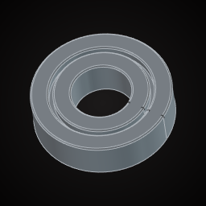 `Bearing_6001` | Bearing 6001 (12×28×8) | Ball bearing 6001: bore 12 mm, OD 28 mm, width 8 mm. Press-fit pocket: OD −0.1 mm. |
| 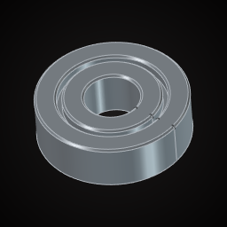 `Bearing_608` | Bearing 608 (8×22×7) | Ball bearing 608: bore 8 mm, OD 22 mm, width 7 mm. Press-fit pocket: OD −0.1 mm. |
| 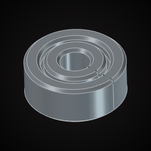 `Bearing_623` | Bearing 623 (3×10×4) | Ball bearing 623: bore 3 mm, OD 10 mm, width 4 mm. Press-fit pocket: OD −0.1 mm. |
|  `Bearing_625` | Bearing 625 (5×16×5) | Ball bearing 625: bore 5 mm, OD 16 mm, width 5 mm. Press-fit pocket: OD −0.1 mm. |
|  `Bearing_6805` | Bearing 6805 (25×37×7) | Ball bearing 6805: bore 25 mm, OD 37 mm, width 7 mm. Press-fit pocket: OD −0.1 mm. |
| 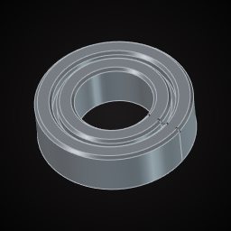 `Bearing_688` | Bearing 688 (8×16×5) | Ball bearing 688: bore 8 mm, OD 16 mm, width 5 mm. Press-fit pocket: OD −0.1 mm. |
| 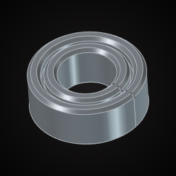 `Bearing_MR105` | Bearing MR105 (5×10×4) | Ball bearing MR105: bore 5 mm, OD 10 mm, width 4 mm. Press-fit pocket: OD −0.1 mm. |

## boards

| File | Part | Notes |
|---|---|---|
| 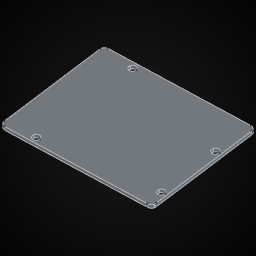 `Arduino_Uno` | Arduino Uno R3 | Arduino Uno R3 PCB outline 68.6 × 53.3 × 1.6 mm, 4 holes 3.2 mm at (14, 2.5), (15.3, 50.7), (66.1, 7.6), (66.1, 35.5). Origin: corner, PCB underside. |
| 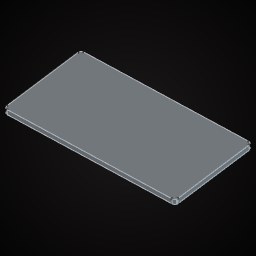 `ESP32_DevKitC` | ESP32 DevKitC | ESP32 DevKitC PCB outline 55 × 28 × 1.6 mm, no mounting holes. Origin: corner, PCB underside. |
| 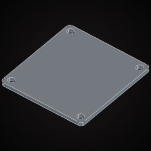 `OLED_0.96_SSD1306` | OLED 0.96&quot; SSD1306 module | OLED 0.96" SSD1306 module PCB outline 27.3 × 27.8 × 1.2 mm, 4 holes 2 mm at (2, 2), (25.3, 2), (2, 25.8), (25.3, 25.8). Origin: corner, PCB underside. |
| 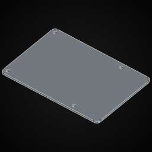 `RaspberryPi_4` | Raspberry Pi 4 B | Raspberry Pi 4 B PCB outline 85 × 56 × 1.6 mm, 4 holes 2.7 mm at (3.5, 3.5), (61.5, 3.5), (3.5, 52.5), (61.5, 52.5). Origin: corner, PCB underside. |
| 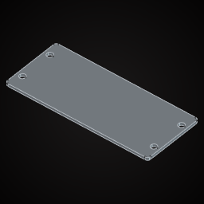 `RaspberryPi_Pico` | Raspberry Pi Pico | Raspberry Pi Pico PCB outline 51 × 21 × 1 mm, 4 holes 2.1 mm at (2, 4.8), (2, 16.2), (49, 4.8), (49, 16.2). Origin: corner, PCB underside. |

## cells

| File | Part | Notes |
|---|---|---|
| 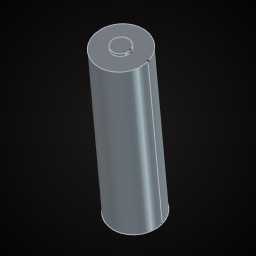 `Cell_18650` | Cell 18650 (18.4×65) | 18650 cell 18.4 mm dia × 65 mm incl. button top. Holder bore: +0.4 mm. |
| 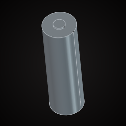 `Cell_21700` | Cell 21700 (21.2×70.2) | 21700 cell 21.2 mm dia × 70.2 mm incl. button top. Holder bore: +0.4 mm. |
| 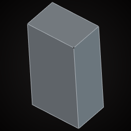 `Cell_9V` | 9 V block | 9 V block 26.5 × 17.5 × 48.5 mm (snap terminals excluded). |
| 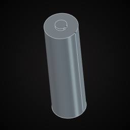 `Cell_AA` | Cell AA (14.5×50.5) | AA cell 14.5 mm dia × 50.5 mm incl. button top. Holder bore: +0.4 mm. |
| 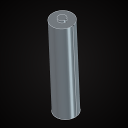 `Cell_AAA` | Cell AAA (10.5×44.5) | AAA cell 10.5 mm dia × 44.5 mm incl. button top. Holder bore: +0.4 mm. |
|  `Cell_CR2032` | Coin cell CR2032 | CR2032 coin cell 20 mm dia × 3.2 mm. |

## electronics

| File | Part | Notes |
|---|---|---|
| 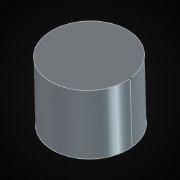 `Buzzer_12mm` | Buzzer 12 mm | Piezo/active buzzer 12 mm dia × 9.5 mm, pins 7.6 mm apart. |
| 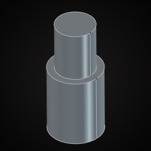 `DC_Jack_5.5x2.1_Panel` | DC jack 5.5×2.1 panel | Panel-mount DC barrel jack 5.5 × 2.1: M8 bushing (8 mm hole, 10 mm long), 14 mm body behind the panel. |
| 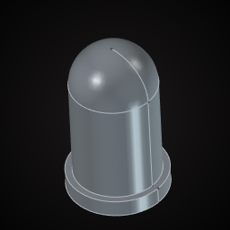 `LED_5mm` | LED 5 mm | 5 mm LED: 5 mm dome, 8.6 mm tall, 5.8 × 1 mm flange at the base. Panel hole 5.1 mm. |
| 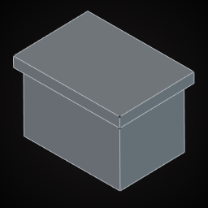 `Rocker_KCD1` | Rocker switch KCD1 | KCD1 rocker: body 19 × 13 mm below a 21 × 15 × 2 mm bezel, 12 mm deep. Panel cutout 19.2 × 13.2 mm. |
| 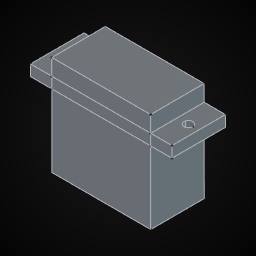 `Servo_SG90` | Servo SG90 | SG90 micro servo: body 22.5 × 12.2 × 22.7 mm, ears 32.2 mm wide, 2 mm holes 27.5 mm apart at 16.5 mm up. Origin: body corner. |
| 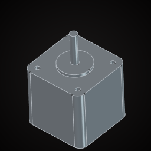 `Stepper_NEMA17_40` | Stepper NEMA 17 (40 mm) | NEMA 17 stepper: 42.3 mm square × 40 mm, 4× M3 on 31 mm square, 22 mm × 2 mm boss, 5 mm shaft 24 mm long. Origin: body corner, shaft up. |
| 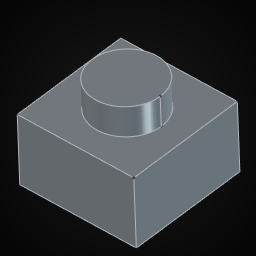 `Tactile_6x6x5` | Tactile switch 6×6×5 | Tactile button 6 × 6 mm, 5 mm tall incl. 3.5 mm dia plunger (1.5 mm above body). |

## fans

| File | Part | Notes |
|---|---|---|
| 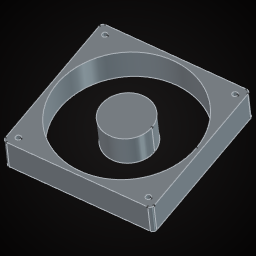 `Fan_120x120x25` | Fan 120×120×25 | Axial fan 120 × 120 × 25 mm, 4 holes 4.3 mm on 105 mm square. Grill cutout: 112.8 mm dia. |
| 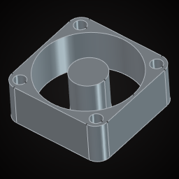 `Fan_25x25x10` | Fan 25×25×10 | Axial fan 25 × 25 × 10 mm, 4 holes 2.9 mm on 20 mm square. Grill cutout: 23.5 mm dia. |
| 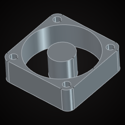 `Fan_30x30x10` | Fan 30×30×10 | Axial fan 30 × 30 × 10 mm, 4 holes 3 mm on 24 mm square. Grill cutout: 28.2 mm dia. |
| 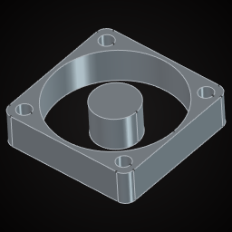 `Fan_40x40x10` | Fan 40×40×10 | Axial fan 40 × 40 × 10 mm, 4 holes 4.3 mm on 32 mm square. Grill cutout: 37.6 mm dia. |
| 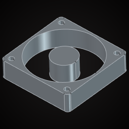 `Fan_60x60x15` | Fan 60×60×15 | Axial fan 60 × 60 × 15 mm, 4 holes 4.3 mm on 50 mm square. Grill cutout: 56.4 mm dia. |
| 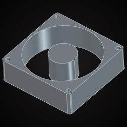 `Fan_80x80x25` | Fan 80×80×25 | Axial fan 80 × 80 × 25 mm, 4 holes 4.3 mm on 71.5 mm square. Grill cutout: 75.2 mm dia. |

## hardware

| File | Part | Notes |
|---|---|---|
| 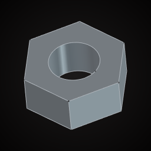 `Nut_M3_Hex` | Hex nut M3 | Hex nut M3: 5.5 mm across flats, 2.4 mm thick. Nut trap: AF +0.3 mm. |
| 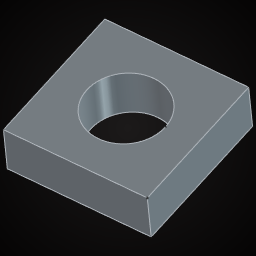 `Nut_M3_Square` | Square nut M3 | Square nut M3 DIN 562: 5.5 × 5.5 × 1.8 mm. Trap: 5.8 mm. |
|  `Nut_M4_Hex` | Hex nut M4 | Hex nut M4: 7 mm across flats, 3.2 mm thick. Nut trap: AF +0.3 mm. |
| 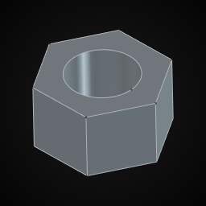 `Nut_M5_Hex` | Hex nut M5 | Hex nut M5: 8 mm across flats, 4.7 mm thick. Nut trap: AF +0.3 mm. |
| 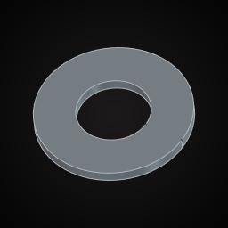 `Washer_M3` | Washer M3 | Washer M3 DIN 125: 7 mm OD × 0.5 mm thick. |
| 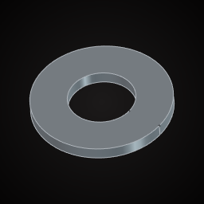 `Washer_M4` | Washer M4 | Washer M4 DIN 125: 9 mm OD × 0.8 mm thick. |
| 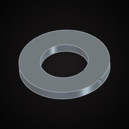 `Washer_M5` | Washer M5 | Washer M5 DIN 125: 10 mm OD × 1 mm thick. |

## inserts

| File | Part | Notes |
|---|---|---|
| 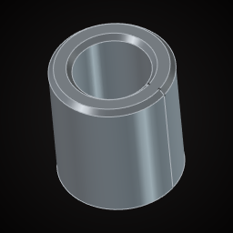 `Insert_M2.5_3.5x4` | Heat-set insert M2.5 3.5×4 | Heat-set insert M2.5, OD 3.5 mm, length 4 mm. Print hole: 3.5 mm dia, 4 mm deep (+1 mm). |
| 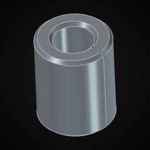 `Insert_M2_3.2x4` | Heat-set insert M2 3.2×4 | Heat-set insert M2, OD 3.2 mm, length 4 mm. Print hole: 3.2 mm dia, 4 mm deep (+1 mm). |
| 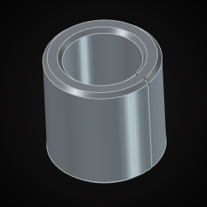 `Insert_M3_4x4` | Heat-set insert M3 4×4 | Heat-set insert M3, OD 4 mm, length 4 mm. Print hole: 4 mm dia, 4 mm deep (+1 mm). |
|  `Insert_M3_4x5.7` | Heat-set insert M3 4×5.7 | Heat-set insert M3, OD 4 mm, length 5.7 mm. Print hole: 4 mm dia, 5.7 mm deep (+1 mm). |
|  `Insert_M4_5.6x8.1` | Heat-set insert M4 5.6×8.1 | Heat-set insert M4, OD 5.6 mm, length 8.1 mm. Print hole: 5.6 mm dia, 8.1 mm deep (+1 mm). |
| 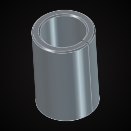 `Insert_M5_6.4x9.5` | Heat-set insert M5 6.4×9.5 | Heat-set insert M5, OD 6.4 mm, length 9.5 mm. Print hole: 6.4 mm dia, 9.5 mm deep (+1 mm). |

## magnets

| File | Part | Notes |
|---|---|---|
|  `Magnet_10x2` | Magnet disc 10×2 | Neodymium disc magnet 10 mm dia × 2 mm. Press pocket: +0.1–0.2 mm dia. |
| 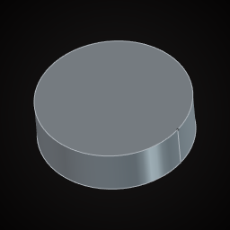 `Magnet_10x3` | Magnet disc 10×3 | Neodymium disc magnet 10 mm dia × 3 mm. Press pocket: +0.1–0.2 mm dia. |
| 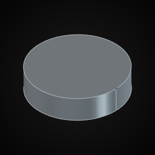 `Magnet_12x3` | Magnet disc 12×3 | Neodymium disc magnet 12 mm dia × 3 mm. Press pocket: +0.1–0.2 mm dia. |
|  `Magnet_5x2` | Magnet disc 5×2 | Neodymium disc magnet 5 mm dia × 2 mm. Press pocket: +0.1–0.2 mm dia. |
|  `Magnet_6x3` | Magnet disc 6×3 | Neodymium disc magnet 6 mm dia × 3 mm. Press pocket: +0.1–0.2 mm dia. |
| 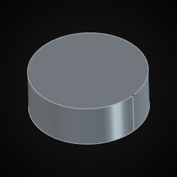 `Magnet_8x3` | Magnet disc 8×3 | Neodymium disc magnet 8 mm dia × 3 mm. Press pocket: +0.1–0.2 mm dia. |
| 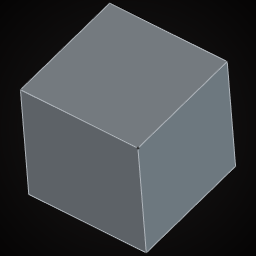 `Magnet_Cube_5` | Magnet cube 5 mm | Neodymium cube magnet 5×5×5 mm. |

## stock

| File | Part | Notes |
|---|---|---|
|  `Dowel_6_100` | Dowel 6 mm | Hardwood dowel 6 mm dia, 100 mm. Hole: 6.2 mm. |
| 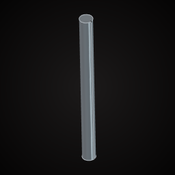 `Dowel_8_100` | Dowel 8 mm | Hardwood dowel 8 mm dia, 100 mm. Hole: 8.2 mm. |
| 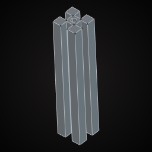 `Extrusion_2020_100` | 2020 extrusion 100 mm | 20 × 20 aluminium extrusion, 100 mm, 6 mm slots (simplified), 4.2 mm core hole. Axis = Z. |
| 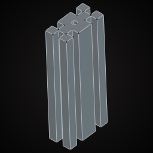 `Extrusion_2040_100` | 2040 extrusion 100 mm | 20 × 40 aluminium extrusion, 100 mm, 6 mm slots (simplified). Axis = Z. |
| 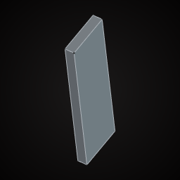 `Lumber_1x4_300` | 1×4 lumber 300 mm | Nominal 1×4: 19 × 89 mm actual, 300 mm long. Axis = Z. |
| 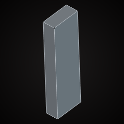 `Lumber_2x4_300` | 2×4 lumber 300 mm | Nominal 2×4: 38 × 89 mm actual, 300 mm long. Axis = Z. |
| 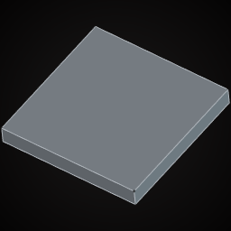 `Ply_12_100x100` | Plywood 12 mm | 12 mm plywood offcut 100 × 100 mm. |
| 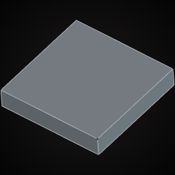 `Ply_18_100x100` | Plywood 18 mm | 18 mm plywood offcut 100 × 100 mm. |
